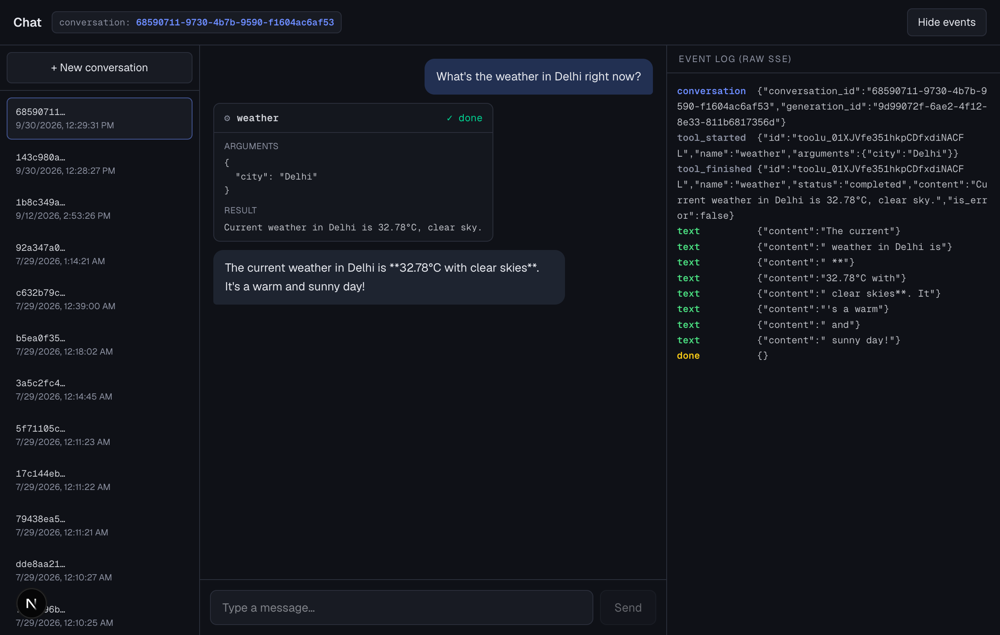
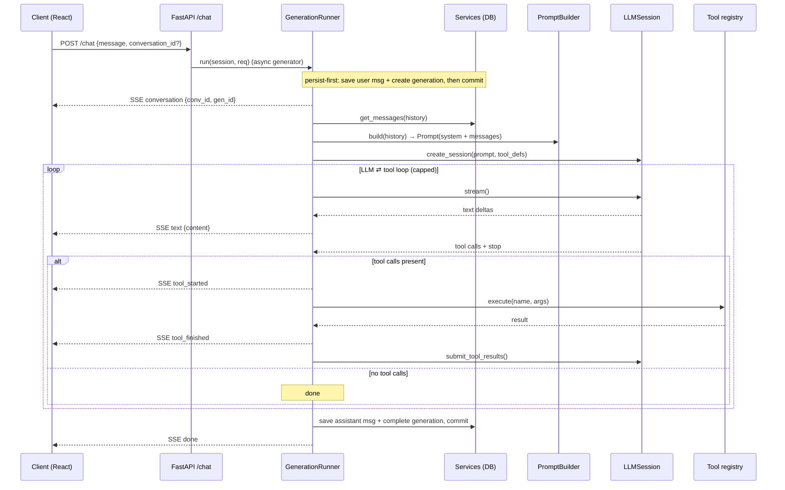

# learn-ai

A streaming, tool-calling LLM chat application built **from first principles** — every
layer derived from the problem it solves before reaching for a framework. The goal isn't
another API wrapper; it's a clean, correct runtime for LLM applications with the hard
parts done properly: token streaming, an agentic tool loop, cooperative cancellation, and
a provider-agnostic session layer.



> Above: a single turn end-to-end. The model requests the `weather` tool, the runner
> executes it and streams `tool_started` / `tool_finished` events, then streams the final
> answer token-by-token. The raw SSE frames are shown on the right.

---

## What it does

- **Streaming chat** over Server-Sent Events — tokens render as they arrive.
- **Agentic tool calling** — the model can call tools (e.g. live weather); the runner runs
  the LLM ⇄ tool loop until the model produces a final answer, capped to prevent runaway
  spend.
- **Live tool visibility** — each tool call renders inline as an expandable card (name,
  arguments, result) in true chronological order within the conversation.
- **Cooperative cancellation** — a generation can be stopped mid-stream; partial output is
  preserved. Distinguishes a *cancellation request* from the *cancellation fact*.
- **Conversation history** — past conversations are listed and can be reopened; prompts are
  rebuilt purely from persisted state (replayable).

---

## Architecture

The system is layered so each concern lives in exactly one place. The HTTP edge knows
nothing about LLM providers; the provider layer knows nothing about HTTP or SSE; the runner
orchestrates but owns no provider or wire details.



### Layers

| Layer | Responsibility | Key files |
|-------|----------------|-----------|
| HTTP edge | Wrap the runner as an SSE `StreamingResponse`; translate events → wire frames | `server/app.py`, `server/events/sse.py` |
| Orchestration | Own the workflow + business transaction; run the LLM ⇄ tool loop; yield app-level events | `server/runners/generation_runner.py` |
| Prompt policy | Decide what the model sees, purely from persisted state | `server/services/prompt_builder.py` |
| Provider | Own all Anthropic-specific message plumbing (tool_use / tool_result) | `server/services/llm_service.py` |
| Tools | Tool definitions, execution, and results as distinct concepts | `server/tools/` |
| Persistence | Conversations, messages, generations | `server/services/`, `server/models.py` |
| Client | Streaming UI, interleaved tool cards, cancellation, history | `client/` |

---

## Design principles (the point of the project)

These distinctions are what keep the system correct as it grows:

- **Conversation ≠ Generation** — a conversation is the thread; a generation is one run.
- **Generation ≠ assistant message** — a run can be cancelled or fail without producing one.
- **State ≠ events** — persisted truth is separate from the event stream describing it.
- **Runner orchestrates; services provide capabilities** — no business logic leaks into services.
- **Provider protocol ≠ application protocol** — the app speaks its own events, not Anthropic's.
- **Tool ≠ ToolExecution ≠ ToolResult** — definition, run, and outcome are separate types.
- **Cancellation request ≠ cancellation fact** — asking to stop is not the same as having stopped.
- **Prompt assembly ≠ persistence** — the prompt is rebuilt from the DB, always replayable.
- **LLMSession owns provider-specific message plumbing** — one place speaks the wire format.

---

## Tech stack

- **Server:** Python, FastAPI, SQLAlchemy, PostgreSQL, Anthropic SDK, SSE
- **Client:** Next.js (App Router), React, TypeScript, Tailwind CSS
- **Model:** Claude (Haiku by default; provider-agnostic session layer)

---

## Running locally

**Server** (from `server/`):

```bash
# needs: DATABASE_URL, ANTHROPIC_API_KEY, OPENWEATHER_API_KEY
ai-venv/bin/uvicorn app:app --port 8000 --reload
```

**Client** (from `client/`):

```bash
npm run dev   # http://localhost:3000
```

---

## Roadmap

This is a staged learning build. The runtime layer above is complete; the current
milestone is **RAG**, followed by **Memory** and **System Maturity** (multi-provider,
observability). The full path — with the specific concepts each stage derives — is frozen
in **[ROADMAP.md](ROADMAP.md)**.
